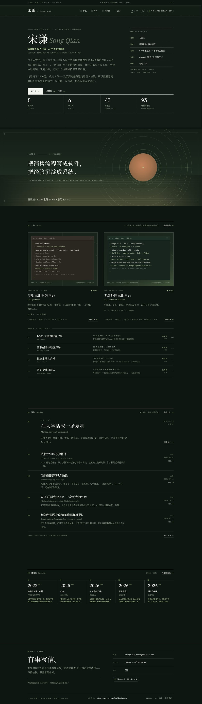
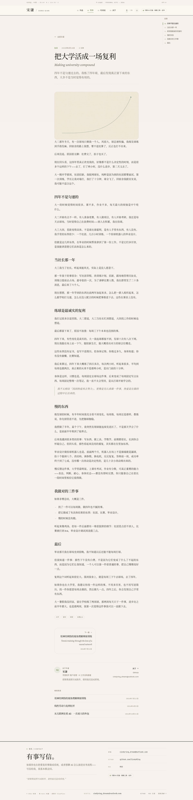

# 宋谦 / Song Qian — Personal Website

The personal site of **宋谦 (Song Qian)** — account manager at [Fumamx](https://www.fumamx.com) in Shijiazhuang, 2026 graduate in IoT engineering, and a builder of AI workflow tools at night.

A hand-built, bilingual (Chinese-first / English at `/en/`) static site in a warm paper-and-ink editorial language: a magazine masthead, oversized serif type, a full-bleed engraved art plate, CLI terminal project cards, and restrained but choreographed motion.

**Live:** https://songqian-personal-website.pages.dev · **Repo:** https://github.com/CindyRIng/songqian-personal-website

## Preview

| Home (light) | Home (dark) | Works |
| --- | --- | --- |
|  |  |  |

| About | Timeline | Writing |
| --- | --- | --- |
|  |  |  |

Mobile (390px):

| Home | Article |
| --- | --- |
|  |  |

---

## Stack

| Layer | Choice |
| --- | --- |
| Framework | [Astro 7](https://astro.build) — static output, `<ClientRouter />` client-side navigation, ~16 KB of JS total |
| Styling | [Tailwind CSS 4](https://tailwindcss.com) + a small semantic token system in `src/styles/global.css` |
| Type | Source Serif 4, Inter, JetBrains Mono — self-hosted variable fonts (Fontsource) |
| i18n | Astro native i18n routing; Chinese at `/`, English at `/en/`; typed dictionary + `src/data/copy.ts` |
| Content | Astro Content Collections (MDX) — 5 essays and 6 case studies, both languages |
| Hosting | Cloudflare Pages |

## Routes

| Route | What it is |
| --- | --- |
| `/` | Information-first hero (role, two paragraphs, quick facts), 5/6/43/93 stat bar, full-bleed art plate, works, writing index, timeline strip |
| `/works` + `/works/<slug>` | Six real tools/projects with CLI terminal cards, honest metrics and case-study bodies |
| `/writing` + `/writing/<slug>` | Five essays as a numbered editorial index; article pages with TOC scroll-spy, code copy, image lightbox, heading anchors and reading progress |
| `/about` | Three threads — sales, code, writing — portrait plate, CV ledger, Now, tools & method |
| `/timeline` | Fourteen entries (2022 → now) grouped by year, with type filters |
| `/en/…` | Every route above in English |
| `/rss.xml`, `/en/rss.xml` | One localized feed per language |

`/projects/*` permanently redirects to `/works/*` (see `public/_redirects`).

## Content

**Essays (5, zh + en):** 把大学活成一场复利 · 线性劳动与复利杠杆 · 我的知识管理方法论 · 从互联网史看 AI · 用神经网络的视角理解网球训练。

**Projects (6, zh + en):** `fuma-platform` · `feige-outbound-platform` · `tennis-ball-robot` · `boss-client` · `zhilian-client` · `tanji-client`.

## Structure

```
src/
├── components/
│   ├── chrome/      # Masthead, SiteFooter, theme toggle
│   ├── home/        # hero, works, writing index, timeline strip, motion
│   ├── ui/          # SectionHeading, StatBar, ArtPlate, TerminalCard, ArrowLink, Icon
│   ├── about/       # portrait plate
│   ├── projects/    # layer diagram
│   ├── timeline/    # timeline entries
│   └── writing/     # essay rows, TOC, reading enhancements
├── content/
│   ├── posts/{zh,en}/<slug>.mdx
│   └── projects/{zh,en}/<slug>.mdx
├── data/
│   ├── copy.ts      # ← every page-level string, zh + en (voice lives here)
│   ├── profile.ts   # ← identity, bio, contact, colophon, SEO
│   └── timeline.ts  # ← 14 localized entries (cv: true → About ledger)
├── i18n/            # locales (zh default, en), typed dictionary, helpers
├── layouts/BaseLayout.astro
├── lib/             # posts / projects helpers
├── pages/           # zh at root, en under /en/
└── styles/          # global tokens + custom Shiki themes
```

## Editing

1. **Voice / page copy** — `src/data/copy.ts` (hero, section leads, contact, meta descriptions; `zh` + `en`).
2. **Identity, bio, contact** — `src/data/profile.ts`. Set `contact.phone` to reveal the phone row; drop a QR at `public/images/wechat-qr.png` to reveal WeChat. Optional portrait: `public/images/portrait.{webp,jpg,png}`; life photos: `public/images/life-*.{webp,jpg}`; handwriting/scans: `public/images/notes-*.{png,jpg}` (sections hide automatically when absent).
3. **Timeline** — `src/data/timeline.ts` (`cv: true` rows appear on About).
4. **Essays** — `src/content/posts/{zh,en}/<slug>.mdx`; **projects** — `src/content/projects/{zh,en}/<slug>.mdx`.
5. **Article covers** — `public/images/posts/<slug>.webp` (5 present; the writing views fall back to generated CSS art when a file is missing).
6. **Social image / manifest** — `public/og/default.png`, `public/site.webmanifest`.
7. **Domain** — update `site` in `astro.config.mjs`, `SITE.url` in `src/i18n/config.ts`, and `public/robots.txt`, then attach the custom domain in Cloudflare Pages.

## Commands

> Node **24** is required by Astro 7. The machine default is older — use the pinned shim:

```bash
source scripts/env.sh        # Node 24 on PATH for this shell
pnpm dev                     # http://localhost:4321
pnpm build                   # static build → dist/
pnpm preview                 # preview the production build
pnpm deploy                  # build + wrangler pages deploy
```

## Design & interaction notes

- **Paper & ink system:** cream `#f7f2ed`, ink `#33302b`, sage `#52692f`, terracotta `#b4653a`, deep-evergreen dark theme. All values are semantic tokens.
- **Magazine masthead:** sticky paper-glass header with a bilingual wordmark, numbered nav and an availability pill; mobile becomes a full-screen paper menu (Esc / scrim / focus trap).
- **Client-side navigation:** Astro `<ClientRouter />`; only the content region cross-fades (90 ms out / 240 ms in, 6 px rise), the chrome stays put. Intent prefetch on hover/focus/touch + idle warm-up of nav destinations + a 30 s HTML cache make page changes near-instant.
- **Motion:** hero stagger, art-plate mask reveal + ±3 % parallax, stat count-up, status-dot breathing, terminal/card hover choreography — every path disabled under `prefers-reduced-motion`, content stays fully readable without JavaScript.
- **Reading:** sticky TOC with scroll-spy, code copy, native `<dialog>` lightbox, heading anchors, reading progress, 18 px prose.
- **SEO:** canonical + `hreflang` (zh-CN / en / x-default), OG/Twitter cards, JSON-LD Person, sitemap (404 excluded), security headers (CSP etc.) and `/projects/*` 301s.

## Deployment

- **Cloudflare Pages** project: `songqian-personal-website` → https://songqian-personal-website.pages.dev
- Manual deploy: `pnpm deploy`.
- **Automated deploy (ready to enable):** `.github/ci/deploy-cloudflare.yml` builds and deploys on every push to `main`. Move it to `.github/workflows/deploy.yml` once the GitHub credential has the `workflow` scope (`gh auth refresh -s workflow`). The `CLOUDFLARE_API_TOKEN` / `CLOUDFLARE_ACCOUNT_ID` repository secrets are already configured.

## License

Content © Song Qian. Code MIT.
