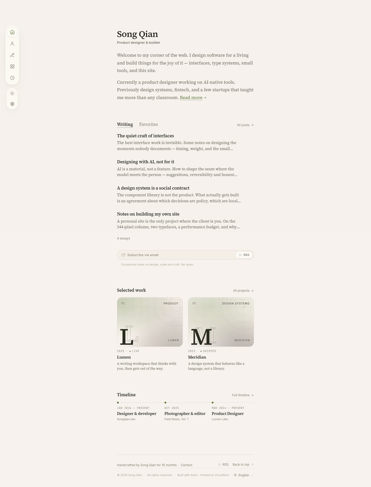
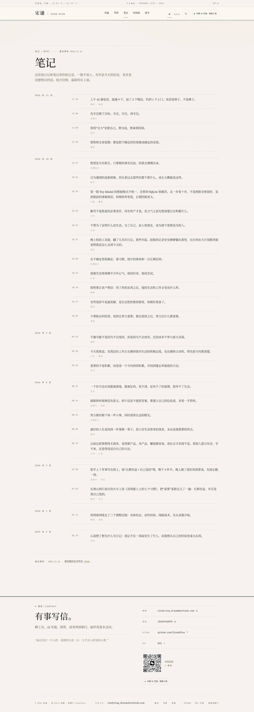
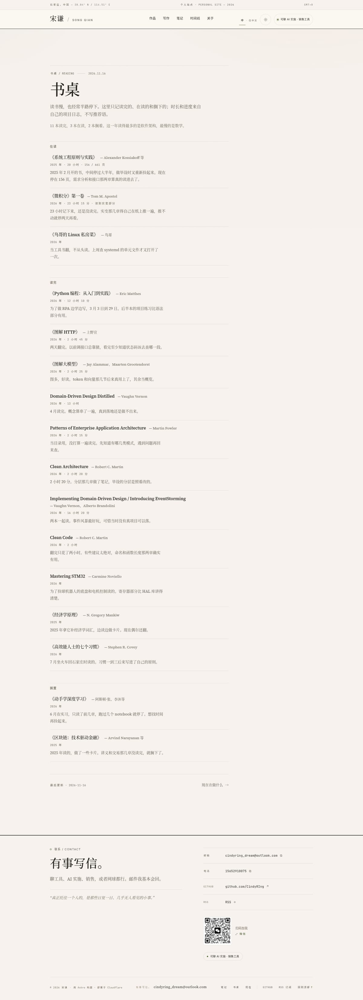
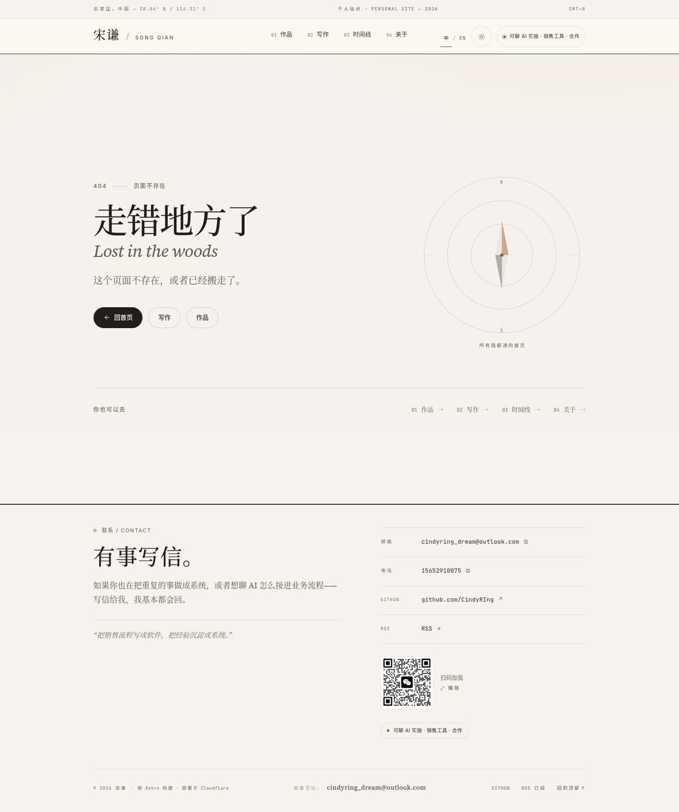
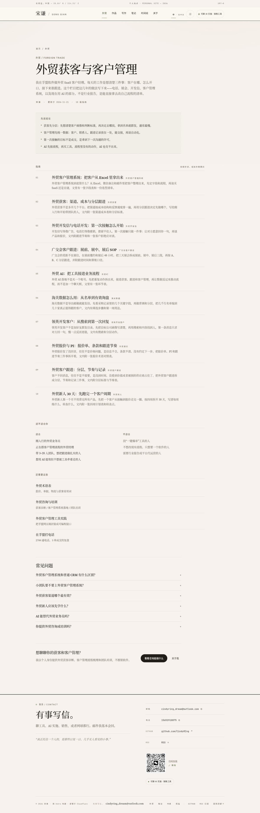
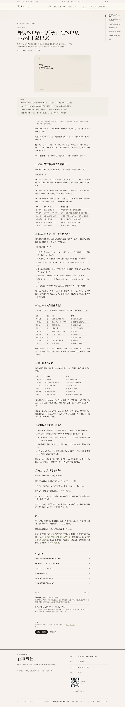

# 宋谦 / Song Qian — Personal Website

The personal site of **宋谦 (Song Qian)** — account manager at [Fumamx](https://www.fumamx.com) in Shijiazhuang, 2026 graduate in IoT engineering, and someone who writes tools, keeps a diary, reads software architecture and calculus, and plays tennis.

Not a portfolio template: a content-first site built from an Obsidian vault of **392 days of journaling, 561 notes and 43 project logs**. Chinese is the primary language; the ten essays are also available in English under `/en/`. It also hosts a practical Chinese **外贸 (foreign-trade) knowledge cluster** — lead generation, customer-management systems, cold outreach, Canton Fair follow-up and AI — plus an independent consulting page.

**Live:** https://songqian.me · **Repo:** https://github.com/CindyRIng/songqian-personal-website

## Preview

| Home (light) | Home (dark) | Notes |
| --- | --- | --- |
|  |  |  |

| Reading | About | Works |
| --- | --- | --- |
|  |  |  |

| Timeline | Writing | 404 |
| --- | --- | --- |
|  |  |  |

| Trade hub | Trade guide |
| --- | --- |
|  |  |

| Mobile | Mobile menu |
| --- | --- |
|  |  |

---

## Stack

| Layer | Choice |
| --- | --- |
| Framework | [Astro 7](https://astro.build) — static output, `<ClientRouter />` client-side navigation, ~24 KB of JS and ~148 KB of CSS (uncompressed) |
| Styling | [Tailwind CSS 4](https://tailwindcss.com) + a small semantic token system in `src/styles/global.css` |
| Type | Source Serif 4, Inter, JetBrains Mono — self-hosted variable fonts (Fontsource) |
| i18n | Astro native i18n routing; Chinese at `/`, English at `/en/`; typed dictionary + `src/data/copy.ts` |
| Content | Astro Content Collections (MDX) for essays and projects; typed data modules for notes, reading and `now` |
| Hosting | Cloudflare Pages (custom domain, www → apex 301, legacy host redirect) |

## Routes

| Route | What it is |
| --- | --- |
| `/` | Content-first home: short intro, real record counts, four recent notes, a dated `Now` strip, selected tools, four recent essays, three books on the desk, a five-node timeline |
| `/writing` + `/writing/<slug>` | Ten essays zh/en as a numbered table of contents; article pages with TOC scroll-spy, code copy, image lightbox, heading anchors and reading progress |
| `/notes` | 28 short, mostly unedited entries from the diary and notes, grouped by month (Chinese only) |
| `/reading` | 17 books: reading, finished, abandoned — with hours, page progress and one honest line each (Chinese only) |
| `/now` | A dated snapshot of what I'm building, reading, training, writing, worrying about (Chinese + English summary) |
| `/works` + `/works/<slug>` | Six self-built tools with CLI terminal cards, honest metrics and case-study bodies |
| `/about` | A letter: three threads, a week in Shijiazhuang, six principles, four failures, the record counts, a short CV, FAQ |
| `/timeline` | Twenty-two entries from 2022 to now, including cancelled projects |
| `/foreign-trade/` | 外贸 pillar page: 外贸获客 / 外贸客户管理 hub with guides, glossary, consulting links and FAQ |
| `/foreign-trade/<slug>/` | Ten guides: 外贸客户管理系统 · 外贸获客 · 开发信与电话开发 · 广交会跟进 · 外贸 AI · 海关数据 · 领英开发 · 报价与 PI · 客户跟进 · 外贸新人 30 天 (Chinese only) |
| `/foreign-trade/glossary/` | 30 外贸术语 in four groups, anchored and cross-linked to the guides (Chinese only) |
| `/consulting/` | Personal-scope 外贸咨询与培训: 获客诊断 / 客户管理系统落地 / 团队培训, with FAQ and a clear disclaimer (Chinese only) |
| `/en/…` | English versions of home, about, timeline, works, writing and articles |
| `/rss.xml`, `/en/rss.xml` | One localized feed per language (10 items each) |

`/projects/*` permanently redirects to `/works/*`.

## Content

- **Essays (10, zh + en):** 把大学活成一场复利 · 线性劳动与复利杠杆 · 我的知识管理方法论 · 从互联网史看 AI · 用神经网络的视角理解网球训练 · 我当下的困境 · 为什么我还在写日记 · 走一步看十步 · 在孚盟打电话 · 网球进阶：把比赛拆成可复盘的东西。
- **Projects (6, zh + en):** `fuma-platform` · `feige-outbound-platform` · `tennis-ball-robot` · `boss-client` · `zhilian-client` · `tanji-client`.
- **Notes (28):** dated entries from 2025-05 to 2026-11.
- **Books (17):** systems engineering, calculus, DDD/architecture, Linux, Python, economics, Covey.
- **Timeline (22):** study, club, internships, thesis, first job, tools, cancelled projects.
- **Foreign-trade guides (10, Chinese):** 外贸客户管理系统 · 外贸获客 · 外贸开发信与电话开发 · 广交会客户跟进 · 外贸 AI · 海关数据 · 领英开发客户 · 外贸报价与 PI · 外贸客户跟进 · 外贸新人 30 天. Each 1,800–2,500 字, with TL;DR, tables, SOPs, FAQs and internal links.
- **Glossary (30 terms):** customers/leads, quotation/contract, logistics/customs, acquisition/channels.
- **Consulting page:** personal-capacity services and constraints, not a software sales page.

### Where the content comes from

Everything human on this site is curated from my own Obsidian vault (diary, notes, project logs, book projects) and edited for the web. Customer names, colleagues, amounts, contracts, relationship details and unpublished business plans are filtered out before publishing; what remains is my own methods, reading, work history and failures. Notes and reading pages are Chinese-first by design — they read like my notebook, not like translated marketing.

## Structure

```
src/
├── components/
│   ├── chrome/      # Masthead, SiteFooter, theme toggle
│   ├── home/        # hero, notes, now, works, writing, reading, timeline strip
│   ├── ui/          # SectionHead, StatBar, TerminalCard, ArrowLink, Icon
│   ├── about/       # portrait plate
│   ├── projects/    # featured cards, rows, layer diagram
│   ├── timeline/    # timeline entries + type colours
│   ├── writing/     # essay rows, TOC, reading enhancements
│   └── views/       # GuideView, GlossaryView, ConsultingView, …
├── content/
│   ├── posts/{zh,en}/<slug>.mdx
│   ├── projects/{zh,en}/<slug>.mdx
│   └── guides/<slug>.mdx          # 外贸 guides (zh-only)
├── data/
│   ├── copy.ts      # ← page-level strings, zh + en
│   ├── profile.ts   # ← identity, bio, contact, colophon
│   ├── timeline.ts  # ← 22 localized entries (cv: true → About CV)
│   ├── notes.ts     # ← dated notes + latestNotes()
│   ├── reading.ts   # ← books + currentlyReading
│   ├── now.ts       # ← the /now snapshot
│   ├── about.ts     # ← about-page sections
│   ├── foreignTrade.ts  # ← 外贸 hub copy + FAQ
│   └── glossary.ts      # ← 30 外贸术语
├── i18n/            # locales (zh default, en), typed dictionary, helpers
├── layouts/BaseLayout.astro
├── lib/             # posts / projects helpers
├── pages/           # zh at root, en under /en/
└── styles/          # global tokens + custom Shiki themes
```

## Editing

1. **Voice / page copy** — `src/data/copy.ts` (`zh` + `en`).
2. **Identity, bio, contact** — `src/data/profile.ts`. Set `contact.phone` to reveal the phone row; drop a QR at `public/images/wechat-qr.png` for WeChat. Optional portrait: `public/images/portrait.{webp,jpg,png}`; life photos: `life-*.{webp,jpg}`; handwriting: `notes-*.{jpg,png}` (sections hide when absent).
3. **Notes** — append to `src/data/notes.ts` (`date`, `text`, optional `tags`/`source`); bump `notesUpdated`.
4. **Reading** — edit `src/data/reading.ts` (`status: read | reading | paused`, optional `hours`/`progress`).
5. **Now** — edit `src/data/now.ts`; `/now` renders it directly.
6. **Timeline** — `src/data/timeline.ts` (`cv: true` rows appear on About).
7. **Essays** — `src/content/posts/{zh,en}/<slug>.mdx`; covers in `public/images/posts/<slug>.webp` (og variants in `public/og/posts/`).
8. **外贸 guides** — `src/content/guides/<slug>.mdx` (`summary`, `faqs`, `keywords`, `related` drive the template and schema); glossary in `src/data/glossary.ts`; consulting copy in `src/views/ConsultingView.astro`.
9. **Domain** — `site` in `astro.config.mjs`, `SITE.url` in `src/i18n/config.ts`, `public/robots.txt`.

## Commands

> Node **24** is required by Astro 7. The machine default is older — use the pinned shim:

```bash
source scripts/env.sh        # Node 24 on PATH for this shell
pnpm dev                     # http://localhost:4321
pnpm build                   # static build → dist/
pnpm preview                 # preview the production build
pnpm deploy                  # build + wrangler pages deploy
node scripts/indexnow.mjs https://songqian.me   # submit sitemap to IndexNow
```

## Design & interaction notes

- **Paper & ink system:** cream `#f7f2ed`, ink `#33302b`, sage `#52692f`, terracotta `#b4653a`, deep-evergreen dark theme. All colours are semantic tokens; body text passes WCAG AA.
- **Content-first home:** no hero manifesto, no decorative art plate; recent notes and `Now` come before the work sections.
- **Notebook pages:** `/notes`, `/reading` and `/now` use dates, thin rules, hanging labels and dense text instead of cards and numbering; Chinese-first with English summaries where it matters.
- **Interaction:** sticky paper-glass masthead, nav underline view transitions, theme wipe, full-screen mobile menu (stagger, focus trap, exact scroll restore), single-link cards, copy-to-clipboard email/phone, WeChat-QR lightbox, filter and FAQ animations, timeline year highlighting, article TOC/lightbox/keyboard flows. Every hover runs only on capable pointers; all motion respects `prefers-reduced-motion`; pages remain readable without JavaScript.
- **Client-side navigation:** only the content region cross-fades; intent prefetch + a short HTML cache keep page changes near-instant.

## SEO strategy — 外贸 keyword cluster

The site is built as a **hub & spoke** around the queries a Chinese foreign-trade buyer actually types. One pillar page, five long guides, a glossary and a service page, all internally linked; every page has one primary keyword and its own FAQ block.

| Page | Primary keyword | Long-tail covered |
|---|---|---|
| `/foreign-trade/` | 外贸获客 / 外贸客户管理 | 外贸流程、外贸客户开发 |
| `/foreign-trade/customer-management/` | **外贸客户管理系统** | 外贸CRM、客户管理软件、CRM选型 |
| `/foreign-trade/lead-generation/` | **外贸获客** | 获客渠道、谷歌开发客户、海关数据、领英获客 |
| `/foreign-trade/outreach/` | 外贸开发信 / 外贸电话开发 | 开发信模板、跟进节奏、WhatsApp、外贸话术 |
| `/foreign-trade/canton-fair/` | 广交会客户跟进 | 展会获客、展前邀约、展后跟进 |
| `/foreign-trade/ai/` | 外贸AI | AI获客、AI客户管理、外贸AI落地 |
| `/foreign-trade/customs-data/` | 海关数据 | 海关数据获客、采购商背调、数据选型 |
| `/foreign-trade/linkedin-prospecting/` | 领英开发客户 | LinkedIn 外贸、领英搜索、私信、目标画像 |
| `/foreign-trade/quotation-and-pi/` | 外贸报价 | 报价单、PI、FOB/CIF、报价跟进 |
| `/foreign-trade/customer-follow-up/` | 外贸客户跟进 | 客户分层、跟进节奏、沉默客户激活 |
| `/foreign-trade/new-salesperson-30-days/` | 外贸新人 | 业务员入门、学习路径、30 天计划、带教 |
| `/foreign-trade/glossary/` | 外贸术语 | PI、FOB、CIF、HS code、报关 |
| `/consulting/` | 外贸咨询 / 外贸培训 | 外贸专家、客户管理系统实施、团队培训 |

E-E-A-T signals: first-person experience (2,700 calls / 3 deals / 6 self-built tools), dated updates, transparent limits and disclaimers, author box on every guide, no invented numbers, no customer or employer-confidential data. Each guide is original (no copying from the vault or company material) and links to the tools and essays that back it up.

## SEO & GEO

- **Canonical domain** `songqian.me`, `hreflang` zh-CN / en / x-default (Chinese-only pages: zh-CN + x-default), per-page titles and descriptions, per-article 1200×630 social images, XML sitemap (60 URLs), two RSS feeds (10 items each), `rel=me` identity links.
- **Structured data:** `Person`, `WebSite`, `Blog`, `BlogPosting` + `BreadcrumbList`, `CollectionPage` + `ItemList`, `SoftwareApplication`/`CreativeWork`, `ProfilePage` + `FAQPage`, `TechArticle` + `FAQPage` on every trade guide, `DefinedTermSet` for the glossary, `ProfessionalService` + `FAQPage` on consulting — all validated JSON-LD (117 blocks, 0 errors).
- **GEO:** `/llms.txt` (entity facts, page map, recent notes/now/reading, all ten 外贸 guides and FAQ) and `/llms-full.txt` (~250 KB: full essays, case studies, notes, now, reading, all ten trade guides with FAQs, the 30-term glossary and consulting summary) generated at build time; `robots.txt` welcomes major LLM crawlers; IndexNow submission to Bing/Yandex.
- **Google Search Console:** verification is wired through `SITE.googleVerification` in `src/i18n/config.ts` (HTML-tag method); paste the token from GSC, redeploy, click verify, then submit `https://songqian.me/sitemap-index.xml`.
- **Legacy URLs:** `/projects/*` → `/works/*`; old `/zh /ja /es /fr /de` prefixes → the two-language routes. The old `pages.dev` host 301s to the domain via `functions/_middleware.ts`.

## Verification

- 62 pages build clean; 0 broken internal links; 0 console errors; one `<h1>` per page.
- CLS 0; no horizontal overflow at 320 / 390 / 768 / 1024 / 1440.
- Keyboard walkthroughs on all interactive flows; reduced-motion and no-JS passes on every page type.

## License

Content © Song Qian. Code MIT.
