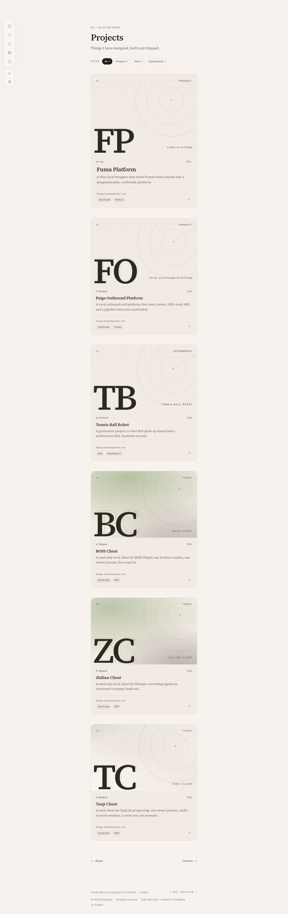

# Song Qian — Personal Website

The personal site of **宋谦 (Song Qian)** — account manager at [Fumamx](https://www.fumamx.com) in Shijiazhuang, 2026 graduate in IoT engineering, and a builder of AI workflow tools by night.

A hand-built, static, six-language site in the spirit of [paulstamatiou.com](https://paulstamatiou.com): warm paper canvas, ink typography, a floating glass navigation rail, and quiet motion.

**Live:** https://songqian-personal-website.pages.dev · **Repo:** https://github.com/CindyRIng/songqian-personal-website

## Preview

| Home (light) | Timeline | About (dark) |
| --- | --- | --- |
|  |  |  |

| Writing | Projects |
| --- | --- |
|  |  |

---

## Stack

| Layer | Choice |
| --- | --- |
| Framework | [Astro 7](https://astro.build) — static output, ~4 KB of client JS |
| Styling | [Tailwind CSS 4](https://tailwindcss.com) + hand-written semantic design tokens |
| Type | Source Serif 4, Inter, JetBrains Mono — self-hosted variable fonts (Fontsource) |
| i18n | Astro native i18n routing + typed dictionary (`src/i18n`) |
| Content | Astro Content Collections (MDX) with locale-aware fallback |
| Hosting | Cloudflare Pages |

## Languages

English is the default (`/`). The other locales are prefixed: `/zh/`, `/ja/`, `/es/`, `/fr/`, `/de/`.
Every page emits `<link rel="alternate" hreflang>` tags, a localized 404, and a language switcher that preserves the current path.
Content that has not been translated yet falls back to English with a subtle note.

## Pages

| Route | What it is |
| --- | --- |
| `/` | Bio, latest writing with a Writing/Favorites tab set, subscribe band, selected work, timeline preview |
| `/about` | Data-driven intro, generated portrait plate, drop-cap bio, CV ledger derived from the timeline, elsewhere links, colophon |
| `/writing` | Essay index with featured lead + pagination; `/writing/<slug>` article pages with sticky TOC, scroll-spy, code copy, image lightbox, heading anchors, reading progress |
| `/projects` | Six real projects (index + case studies) with generated cover plates and category filters |
| `/timeline` | 14-entry career/life timeline with year groups, type filters and a Now block |
| `/404` | Localized not-found page |

## Content

**Essays** (adapted from the owner's personal knowledge base, written in all six languages):

1. *Make your university years compound* — 把大学活成一场复利
2. *Tennis training through the lens of a neural network* — 用神经网络的视角理解网球训练
3. *Linear labour and compounding leverage* — 线性劳动与复利杠杆
4. *How I manage my knowledge* — 我的知识管理方法论
5. *AI after the internet: a bigger kind of outsourcing* — 从互联网史看 AI：一次更大的外包

**Projects** (real repositories):

| Project | What it is |
| --- | --- |
| `fuma-platform` | A local wrapper around the Fumamx web console — multi-account session pool, request pool, local fact store, customs cache, event bus; one wrapping, four entry points (CLI/REST/MCP/SKILL) |
| `feige-outbound-platform` | Local outbound-calling platform: REST/CLI/MCP/SKILL, multi-account auto-login, local ASR with speaker separation, DeepSeek post-processing, call orchestration |
| `tennis-ball-robot` | Graduation thesis: a five-layer architecture for a ball-collecting robot (differential drive, roller pickup, 3D-printed chassis) |
| `boss-client` | Read-only local client for BOSS Zhipin: persistent browser session, 16 stable operations, CLI/REST/OpenAPI/MCP/SKILL |
| `zhilian-client` | Read-only local client for Zhaopin: 17 MCP tools, four channels, SQLite cache, OpenAPI |
| `tanji-client` | Local client for Tanji AI prospecting: multi-account sessions, enterprise search, systemd-resident service |

## Structure

```
src/
├── components/
│   ├── chrome/      # floating nav, footer, theme toggle, language switcher
│   ├── home/        # home sections
│   ├── about/       # portrait plate
│   ├── projects/    # generated cover art, project cards
│   ├── timeline/    # timeline entries
│   ├── writing/     # post rows, TOC, reading enhancements
│   └── ui/          # Icon, SectionHeader, …
├── content/
│   ├── posts/<locale>/<slug>.mdx
│   └── projects/<locale>/<slug>.mdx
├── data/
│   ├── profile.ts   # ← identity, bio, socials, colophon, SEO
│   └── timeline.ts  # ← 14 localized timeline entries
├── i18n/            # locales, dictionary (6 × ~120 strings), helpers
├── layouts/BaseLayout.astro
├── lib/             # posts / projects / format helpers
├── pages/           # routes (default locale at root + [lang]/ mirrors)
├── styles/global.css            # tokens, prose, motion primitives
└── styles/shiki/                # custom dual syntax-highlighting themes
```

## Editing

There is no CMS — content is Markdown/MDX and typed data committed to the repo.

1. **Identity** — `src/data/profile.ts` (name, role, tagline, bio, socials, colophon, SEO).
2. **Timeline** — `src/data/timeline.ts` (localized entries; `cv: true` rows appear on About).
3. **Essays** — `src/content/posts/<locale>/<slug>.mdx` (same slug across locales links translations).
4. **Projects** — `src/content/projects/<locale>/<slug>.mdx`.
5. **Images** — article covers live in `public/images/posts/` (`<slug>.webp`); the writing views detect them at build time and fall back to generated CSS art when absent.
6. **OG image / manifest** — `public/og/default.png`, `public/site.webmanifest`.
7. **Domain** — update `site` in `astro.config.mjs`, `SITE.url` in `src/i18n/config.ts`, and `public/robots.txt`, then attach the custom domain in Cloudflare Pages.

## Commands

> Node **24** is required by Astro 7. The system default here is older, so use the pinned shim:

```bash
source scripts/env.sh        # Node 24 on PATH for this shell
pnpm dev                     # http://localhost:4321
pnpm build                   # static build → dist/
pnpm preview                 # preview the production build
pnpm deploy                  # build + wrangler pages deploy
```

## Deployment

- **Cloudflare Pages** project: `songqian-personal-website` → https://songqian-personal-website.pages.dev
- Manual deploy: `pnpm deploy`.
- **Automated deploy (ready to enable):** `.github/ci/deploy-cloudflare.yml` builds and deploys on every push to `main`. Move it to `.github/workflows/deploy.yml` once the GitHub credential has the `workflow` scope (`gh auth refresh -s workflow`). Repository secrets `CLOUDFLARE_API_TOKEN` and `CLOUDFLARE_ACCOUNT_ID` are already configured.

## Design notes

- Colors, spacing, radii, shadows and easings are semantic tokens in `src/styles/global.css`; components never hard-code hex values.
- Light: warm cream paper (`#f7f2ed`) + warm ink (`#33302b`) + muted sage (`#52692f`). Dark: deep evergreen (`#0e1611`) with a desaturated sage accent.
- The theme toggle reveals the new theme as a circle expanding from the click point (View Transitions API; disabled under `prefers-reduced-motion`).
- Reading experience: sticky TOC with scroll-spy, code copy buttons, native `<dialog>` image lightbox, heading anchors, reading progress.
- Project and portrait artwork is generated deterministically from a seed (CSS/SVG only) — no stock photography, no licensing issues.
- Fonts are self-hosted, subset by unicode-range, and swap without layout shift.
- Site-wide: semantic landmarks, skip link, visible focus rings, 44 px touch targets, AA contrast tokens, print styles, and a fully readable no-JavaScript fallback.

## License

Content © Song Qian. Code MIT.
