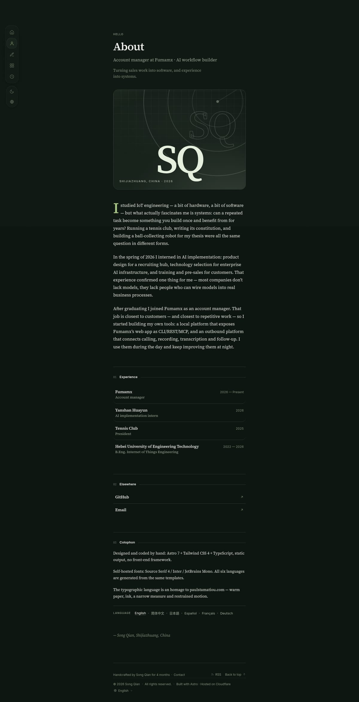

# Song Qian — Personal Website

A hand-built personal site in the spirit of [paulstamatiou.com](https://paulstamatiou.com): warm paper canvas, ink typography, a floating glass navigation pill, and the occasional moment of quiet motion. Six languages, light and dark themes, zero client-side frameworks.

**Live:** https://songqian-personal-website.pages.dev

## Preview

| Home (light) | Timeline | About (dark) |
| --- | --- | --- |
|  |  |  |

---

## Stack

| Layer | Choice |
| --- | --- |
| Framework | [Astro 7](https://astro.build) (static output, zero JS by default) |
| Styling | [Tailwind CSS 4](https://tailwindcss.com) + hand-written CSS design tokens |
| Type | Source Serif 4, Inter, JetBrains Mono — self-hosted variable fonts via Fontsource |
| i18n | Astro's native i18n routing + typed dictionary (`src/i18n`) |
| Content | Astro Content Collections (MDX) with locale-aware fallback |
| Hosting | Cloudflare Pages (CI: GitHub Actions) |

## Languages

English is the default (`/`). Every other locale is prefixed: `/zh/`, `/ja/`, `/es/`, `/fr/`, `/de/`.
Every page emits `<link rel="alternate" hreflang>` tags; the language switcher preserves the current path.
Content that has not been translated yet gracefully falls back to English with a subtle note.

## Project structure

```
src/
├── components/
│   ├── chrome/      # floating nav, footer, theme toggle, language switcher
│   ├── home/        # home page sections
│   ├── about/       # about page sections
│   ├── projects/    # project cards, cover art, metadata
│   ├── timeline/    # timeline rail + entries
│   ├── writing/     # post rows, article header, prev/next
│   └── ui/          # Icon, SectionHeader, PostRow, CoverArt, …
├── content/
│   ├── posts/<locale>/<slug>.mdx
│   └── projects/<locale>/<slug>.mdx
├── data/
│   ├── profile.ts   # ← identity, bio, socials, CV, colophon
│   └── timeline.ts  # ← timeline entries (localized)
├── i18n/
│   ├── config.ts    # locales, default locale, site constants
│   ├── ui.ts        # every chrome string × 6 locales
│   └── utils.ts     # t(), localizePath(), getAlternates(), formatDate()…
├── layouts/BaseLayout.astro   # <head>, theme bootstrap, nav, footer
├── lib/             # posts / projects content helpers
├── pages/           # routes (default locale at root + [lang]/ mirrors)
└── styles/global.css          # design tokens, prose, motion primitives
```

## Editing the site

**Everything about the person lives in two places:**

1. `src/data/profile.ts` — name, role, bio, location, socials, experience, colophon, SEO defaults.
2. `src/content/posts/<locale>/*.mdx` and `src/content/projects/<locale>/*.mdx` — writing and case studies.
3. `src/data/timeline.ts` — career/life timeline entries (localized).

There is no CMS: content is Markdown/MDX committed to the repo.

### Add a post

```bash
# 1. create the EN file
src/content/posts/en/my-new-post.mdx
# 2. optional translations (same filename slug)
src/content/posts/zh/my-new-post.mdx
```

```mdx
---
title: 'A title that earns its line break'
description: 'One sentence that makes someone want to read the next one.'
date: 2026-05-01
tags: ['design', 'craft']
category: design
featured: false
---

Body in Markdown. Headings, lists, quotes, code and figures are all pre-styled.
```

Page size for the writing index is `POSTS_PAGE_SIZE` in `src/lib/posts.ts`.

### Add a project

`src/content/projects/<locale>/<slug>.mdx` with frontmatter validated by `src/content.config.ts`.
The list page is generated automatically; `featured: true` and `order` control the home page grid.

## Replacing the placeholder content

The site currently ships with a realistic placeholder persona so that every page can be reviewed end-to-end. Replace it in this order:

| What | Where | Notes |
| --- | --- | --- |
| Name, role, bio, location, email, social links | `src/data/profile.ts` | All six languages, one object |
| Home + About copy | `src/data/profile.ts` (`homeBio`, `aboutBio`, `now`, `colophon`) | `L` maps: `{ en, zh, ja, es, fr, de }` |
| CV rows on About | derived from `src/data/timeline.ts` | Keep the two in sync |
| Career/life timeline | `src/data/timeline.ts` | `TODO(content-owner)` markers |
| Projects (4 × 6 locales) | `src/content/projects/<locale>/*.mdx` | Add real links in `links:` when available |
| Essays (4 × 6 locales) | `src/content/posts/<locale>/*.mdx` | Same slug across locales links translations |
| Portrait / photos | `src/components/projects/CoverArt.astro` accepts an `image` prop; or set a real image on the About portrait | Until then, generated art plates are used |
| Social handles in footer/SEO | `src/data/profile.ts`, `src/i18n/config.ts` (`SITE`) | |
| OG image | `public/og/default.png` (1200×630) | Regenerate with `sharp` if the name/role changes |
| Domain | `astro.config.mjs` → `site`, `src/i18n/config.ts` → `SITE.url`, `public/robots.txt` | One-line change each; then add the custom domain in Cloudflare Pages |

## Commands

> Node **24** is required by Astro 7. On this machine the default `node` is older, so use the helper:

```bash
source scripts/env.sh        # puts Node 24 on PATH for the session
pnpm dev                     # http://localhost:4321
pnpm build                   # static build → dist/
pnpm preview                 # preview the production build
pnpm check                   # astro check (types + templates)
pnpm deploy                  # build + wrangler pages deploy
```

## Deployment

- **Cloudflare Pages** project: `songqian-personal-website` → https://songqian-personal-website.pages.dev
- **Custom domain**: buy it (e.g. `songqian.dev`, `songqian.me`), add it in the Pages project, then update the three URLs listed in “Replacing the placeholder content” and redeploy.
- Every push to `main` triggers `.github/workflows/deploy.yml`, which builds and deploys via `wrangler-action`.
- Required repository secrets: `CLOUDFLARE_API_TOKEN`, `CLOUDFLARE_ACCOUNT_ID`.

## Design notes

- Colors, spacing, radii, shadows, easings are semantic tokens in `src/styles/global.css` — components never hard-code hex values.
- Light theme: warm cream paper (`#f7f2ed`) and warm ink (`#33302b`) with a muted sage accent.
- Dark theme: deep evergreen (`#0e1611`) with a desaturated sage accent.
- The theme toggle uses the View Transitions API to reveal the new theme as a circle expanding from the click point (disabled under `prefers-reduced-motion`).
- Cover art is generated deterministically from a seed — no stock photography, no licensing issues.
- Fonts are self-hosted, subset by unicode-range, and swap in without layout shift.

## License

Content © Song Qian. Code MIT.
